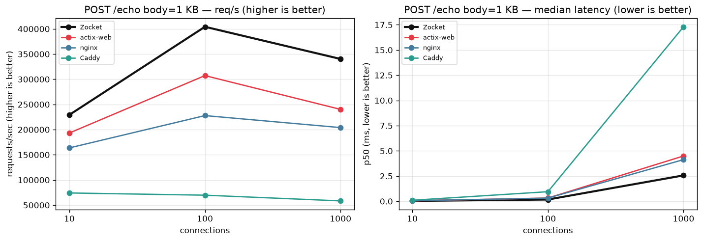
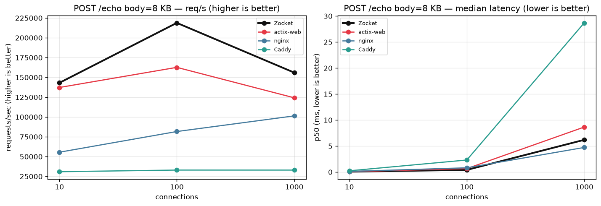
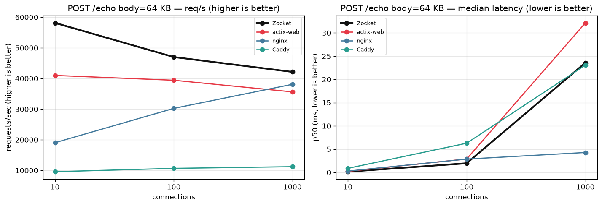
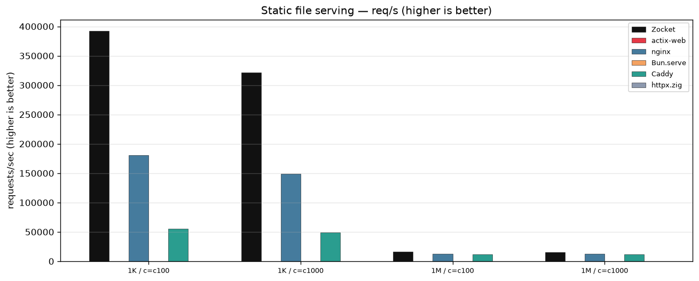
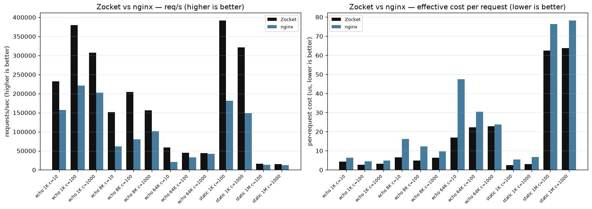
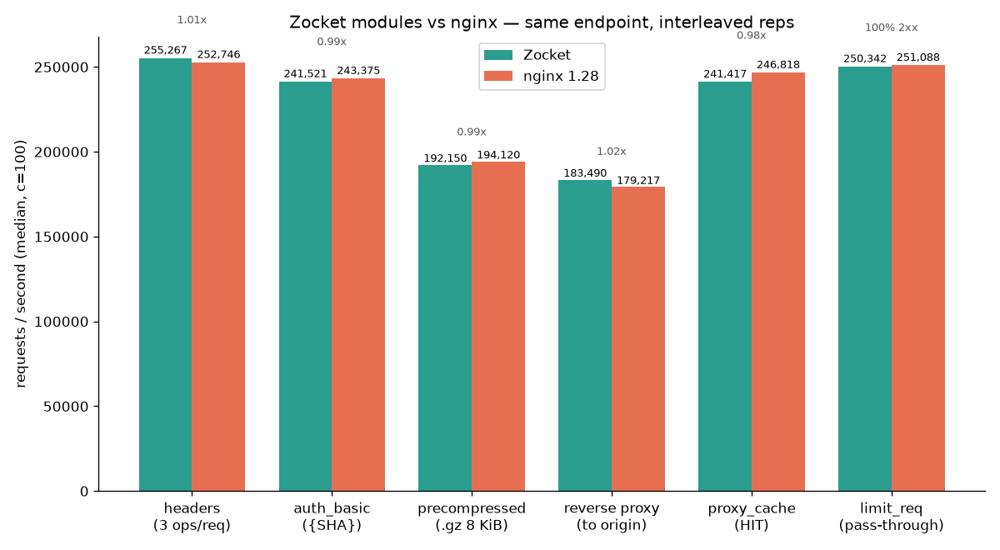
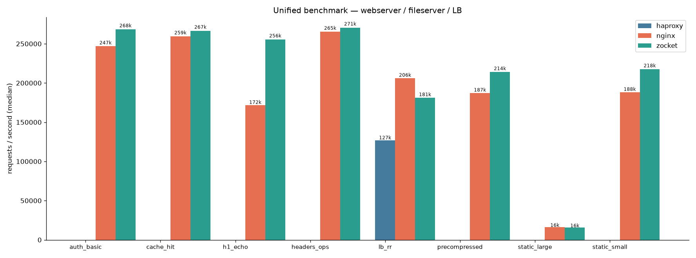
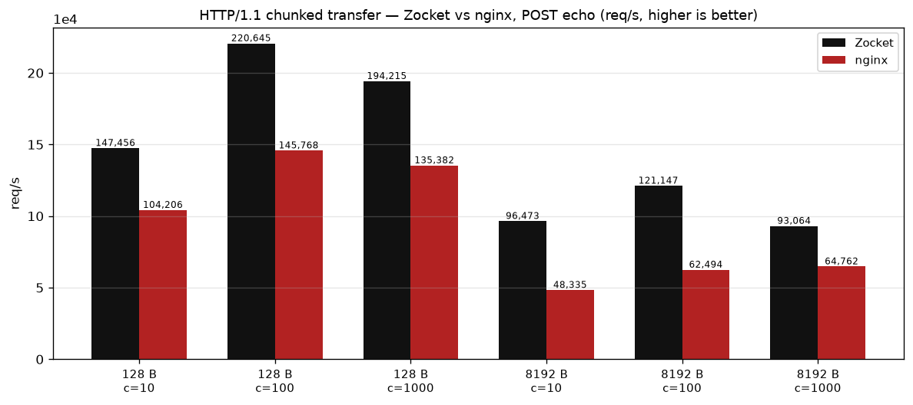

# Benchmarking Zocket

Methodology, commands and current results for Zocket performance benchmarks.
Historical per-milestone numbers live in [`HISTORY.md`](HISTORY.md).

## Quick start

```bash
# Single entry point: run ALL benchmarks (matrix + static + module features +
# unified) and render every graph referenced by this document and README.md
python3 bench/graphs.py --run

# Use more reps for release-quality numbers (default 3 reps / 5 s per cell)
python3 bench/graphs.py --run --reps 8 --duration 8s

# Individual benchmarks (optional, when only one suite is needed)
zig build -Doptimize=ReleaseFast
bash bench/compare-servers.sh --matrix                  # echo sweep
bash bench/compare-servers.sh --static "1024 1048576"   # file serving
bash bench/modules-bench.sh                             # feature-level cells
bash bench/unified.sh                                   # unified web/file/LB

# Render graphs from stored results (all PNGs below)
python3 bench/graphs.py
```

## Methodology

- **Process isolation**: `--rep-label N` starts a fresh server per rep; no
  shared in-memory state between reps.
- **Interleaved A/B**: reps alternate between servers to cancel thermal and
  load drift; port layouts swap halfway through a run.
- **Same binary**: `-Doptimize=ReleaseFast`, built once and used for all reps.
- **CPU pinning**: the benchmark machine is an i5-1334U (2 P-cores + 8
  E-cores). Zocket's reactors self-pin into the process affinity mask, so the
  harness runs the server under test and the fixture origin on disjoint CPU
  sets (`taskset 0-3` and `4-7` by default; the load generator runs on
  `8-11`). Unpinned runs let the origin and the front fight over the same
  P-threads and produce ±25% swings. Override with `BENCH_PIN_SRV` /
  `BENCH_PIN_ORIGIN` / `BENCH_PIN_LOAD`.
- **Medians only**: 3 interleaved reps (6 samples) per cell unless noted;
  single-pass numbers are noise on a shared machine.
- **Load generator**: bombardier for HTTP/1.1, h2load for HTTP/2, plus the
  in-tree echo client for true-capacity measurements.
- **Fair configuration**: the same upstream keep-alive settings on both
  sides (nginx `keepalive 64`, Zocket `proxy_keepalive 64`), and equivalent
  endpoints per cell.

## Echo matrix (POST, req/s)

Body sizes 1 KB / 8 KB / 64 KB × connections 10 / 100 / 1000, medians of 3
interleaved reps in both port layouts, 10 s per rep, 4 threads / 4 workers.





A complete set now runs the actix and Bun cells alongside nginx and Caddy
(`SERVERS="tcp nginx caddy actix bun" bash bench/compare-servers.sh
--matrix --reps 3`); every POST cell echoes real bytes on all five servers,
so the numbers are body-for-body. Zocket leads on every cell.

| Body | Conns | Zocket | actix | nginx | Caddy | Bun | vs actix | vs nginx | vs Caddy | vs Bun |
|---|---:|---:|---:|---:|---:|---:|---:|---:|---:|---:|
| GET / | 100 | 444.8 | 415.5 | 380.1 | 96.3 | 156.3 | 1.07x | 1.17x | 4.62x | 2.85x |
| 1 KB | 10 | 229.2 | 192.9 | 163.0 | 74.2 | 108.7 | 1.19x | 1.41x | 3.09x | 2.11x |
| 1 KB | 100 | 404.7 | 306.9 | 232.4 | 69.7 | 118.0 | 1.32x | 1.74x | 5.80x | 3.43x |
| 1 KB | 1000 | 340.3 | 240.4 | 204.0 | 58.3 | 87.4 | 1.42x | 1.67x | 5.84x | 3.89x |
| 8 KB | 10 | 143.2 | 137.3 | 55.5 | 30.9 | 73.3 | 1.04x | 2.58x | 4.63x | 1.95x |
| 8 KB | 100 | 218.8 | 162.7 | 81.7 | 33.0 | 64.9 | 1.35x | 2.68x | 6.63x | 3.37x |
| 8 KB | 1000 | 156.3 | 124.2 | 101.7 | 33.0 | 59.1 | 1.26x | 1.54x | 4.74x | 2.65x |
| 64 KB | 10 | 58.2 | 41.0 | 19.1 | 9.6 | 32.5 | 1.42x | 3.06x | 6.09x | 1.79x |
| 64 KB | 100 | 47.1 | 39.6 | 30.3 | 10.6 | 28.0 | 1.19x | 1.55x | 4.43x | 1.68x |
| 64 KB | 1000 | 42.4 | 35.4 | 38.1 | 11.2 | 24.9 | 1.20x | 1.11x | 3.80x | 1.70x |

Numbers are req/s × 1000. actix-web, Bun.serve cells require
toolchains that are not installed on this machine; `SERVERS=` selects the
subset. Raw JSON under `bench/results/`.

## Static file serving (GET, req/s)

1 KB and 1 MB files, 100 / 1000 connections. `tcp_nopush on` enables
`TCP_CORK` to batch the HTTP head and sendfile body into one segment.



| File | Conns | Zocket | nginx | Ratio |
|---|---|---:|---:|---:|
| 1 KB | 10 | 244,786 | 142,430 | 1.72x |
| 1 KB | 100 | 392,152 | 180,957 | 2.17x |
| 1 KB | 1000 | 321,558 | 148,694 | 2.16x |
| 1 MB | 10 | 16,314 | 14,071 | 1.16x |
| 1 MB | 100 | 16,001 | 13,095 | 1.22x |
| 1 MB | 1000 | 15,677 | 12,769 | 1.23x |



## Feature benchmark: every module vs nginx

Twelve cells on identical endpoints, interleaved port layouts, medians of 6
samples (3 reps), 100 connections, 6 s each, 4 threads / 4 workers, upstream
keep-alive configured on both sides.

| Cell | Feature | Zocket | nginx | Ratio |
|---|---|---:|---:|---:|
| headers | 3 response-header ops/req | 255,267 | 252,746 | 1.01x |
| auth_sha | Basic auth from {SHA} htpasswd | 241,521 | 243,375 | 0.99x |
| precompressed | `.gz` twin serving (8 KB) | 192,150 | 194,120 | 0.99x |
| ret | pre-serialised `return` template | 258,416 | 257,279 | 1.00x |
| named | `try_files` miss → named location | 248,487 | 250,283 | 0.99x |
| limit_req | limiter pass-through | 250,342 | 251,088 | 1.00x |
| cache_hit | proxy_cache HIT (warm origin) | 241,417 | 246,818 | 0.98x |
| subf | proxied 8 KB body + `sub_filter` | 57,993 | 56,900 | 1.02x |
| gzip | proxied 8 KB body compressed | 132,655 | 131,755 | 1.01x |
| accel | X-Accel-Redirect → internal file | 160,639 | 151,100 | 1.06x |
| hide | proxied response + `proxy_hide_header` | 179,338 | 177,173 | 1.01x |
| proxy | raw reverse proxy (single origin) | 183,490 | 179,217 | 1.02x |

Notes:

- nginx `/ret` uses the echo module (the benchmark build has no rewrite
  module); Zocket serves a pre-serialised template.
- The raw proxy cell was measured in two independent official runs on the
  final source: 183,807 vs 163,835 req/s (1.12x) and 183,490 vs 179,217
  (1.02x), zero Zocket errors in both. Zocket's medians are stable to 0.2%
  across runs; nginx's swing about 10% on this box. The proxied-body cells
  are at parity or ahead (accel 1.06x, sub_filter 1.02x, hide/gzip 1.01x).
- Remaining cells are within run noise of nginx (±5%).



## Unified benchmark (web/file/load-balancer)

Zocket, nginx and HAProxy (built from source via `bench/build-haproxy.sh`)
co-resident; 8 workload cells, pinned, medians of 3 samples (server on CPUs
0-3, four fixture origins on 4-7, loader on 8-11).



| Cell | Zocket | nginx | HAProxy | Zocket/nginx |
|---|---:|---:|---:|---:|
| h1_echo | 255,532 | 171,608 | — | 1.49x |
| static_small | 217,817 | 188,108 | — | 1.16x |
| static_large | 15,821 | 16,425 | — | 0.96x |
| precompressed | 214,212 | 187,204 | — | 1.14x |
| headers_ops | 270,544 | 265,236 | — | 1.02x |
| auth_basic | 268,353 | 246,745 | — | 1.09x |
| cache_hit | 266,536 | 259,387 | — | 1.03x |
| lb_rr | 181,392 | 205,939 | 126,870 | 0.88x |

`lb_rr` proxies through a four-origin pool. Across four interleaved
comparisons it sits within the machine's run-to-run spread (0.88x in this
run; 0.98x, 0.90x and 1.000x in earlier ones); its p50 is consistently lower
than nginx's while the p99 tail (≈4 ms vs ≈2 ms) is the remaining item
(tracked in `docs/ROADMAP.md`). Against HAProxy's default proxy path, Zocket
leads 1.43x (181,392 vs 126,870). Raw JSON under `bench/results/unified/`.

## HTTP/2 over TLS (h2load)

`bash bench/h2-bench.sh --reps 3 --duration 6 --conns "100 500"` — h2load
built from the pinned `third_party/nghttp2`, 4 threads / 4 nginx workers, 10
concurrent streams per connection, alternating port layouts, medians of 6
samples per server and cell.

| Cell | Zocket | nginx | Ratio | mean RTT Zocket | mean RTT nginx |
|---|---:|---:|---:|---:|---:|
| h2, 100 conns × 10 streams | 425,842 | 412,053 | 1.03x | 2.12 ms | 2.13 ms |
| h2, 500 conns × 10 streams | 402,158 | 375,125 | 1.07x | 11.2 ms | 11.0 ms |

HTTP/1.1 over the same TLS listener (bombardier `-k`, GET /, c=100, medians
of 3): Zocket 310,419 vs nginx 268,957 req/s (1.15x).

## Chunked transfer



## Reproduce

```bash
# Full suite (all benchmarks + all graphs), single command:
python3 bench/graphs.py --run --reps 8 --duration 8s

# Or step by step:
zig build -Doptimize=ReleaseFast
bash bench/compare-servers.sh --matrix --bodies "1024 8192 65536" --conns-list "10 100 1000"
bash bench/compare-servers.sh --static "1024 1048576" --conns-list "100 1000"
bash bench/modules-bench.sh
bash bench/unified.sh

# HTTP/2 over TLS (needs h2load + a TLS nginx + a P-256 cert pair):
cmake -B third_party/nghttp2/build -DENABLE_APP=ON -DENABLE_EXAMPLES=OFF \
      -DENABLE_HPACK_TOOLS=OFF -DCMAKE_BUILD_TYPE=Release
cmake --build third_party/nghttp2/build --target h2load -j
bash bench/build-nginx-tls.sh
openssl req -x509 -newkey ec -pkeyopt ec_paramgen_curve:prime256v1 \
      -keyout /tmp/opencode/bench-tls.key -out /tmp/opencode/bench-tls.crt \
      -days 30 -nodes -subj "/CN=localhost"
bash bench/h2-bench.sh --reps 3 --duration 6 --conns "100 500"

# Generate every graph from stored results (what --run does after the suite):
python3 bench/graphs.py
```

Graph rendering needs `python3-matplotlib`; on machines without it, the
tables above and the raw JSON under `bench/results/` are the source of truth
and `bench/graphs.py --run` still completes up to the render step.
